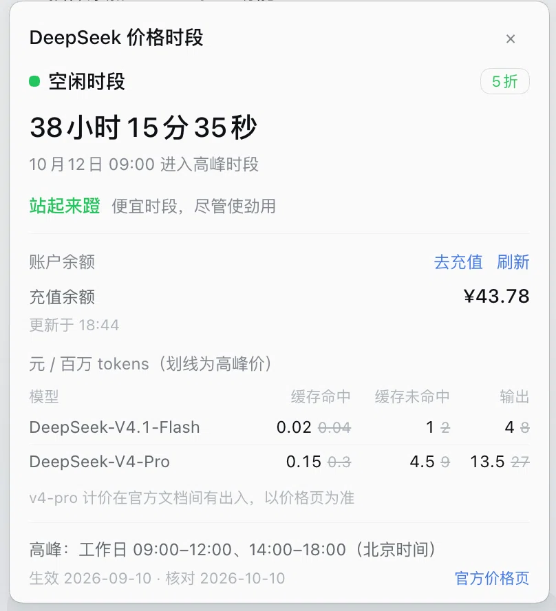

# dsh-price-tip — DeepSeek 价格时段提醒

*[English](README.en.md) · 中文*

DSH（DeepSeek Harness）插件：在 Web 界面**侧栏底部**常驻一个价格时段标记，显示 DeepSeek API 当前处于
**空闲时段**还是**高峰时段**、距下次切换还有多久；点开是规则说明、当前生效的价目表，以及已登录
DeepSeek 账户的余额。


*侧栏底部实拍：绿色月牙 = 空闲时段，状态文案旁是绿色口号，右侧为距下次切换的倒计时。*



*点击展开：当前时段与折扣、剩余时间与切换时刻（本机时区、跟随界面语言）、口号、账户余额（充值/赠送余额、
更新时间、刷新与去充值）、价目表（加粗为当前价、划线为高峰价），以及底部的规则与来源。深色主题下的侧栏与面板见
[docs/verification.md](docs/verification.md)。*

## 它提醒什么

| 时段 | 北京时间 | 价格 |
| --- | --- | --- |
| 高峰 | 周一至周五 09:00–12:00、14:00–18:00（不含中国法定节假日） | 标准价 |
| 空闲 | 其余全部时间，含周末与法定节假日全天 | 高峰价的 50% |

> ⚠️ 2025 年那套「00:30–08:30 错峰优惠」已于 2025-09-05 取消，`deepseek-chat` / `deepseek-reasoner`
> 也已于 2026-07-24 下线——**都不是现行规则**。规则与价目表以
> [DeepSeek 官方价格页](https://api-docs.deepseek.com/zh-cn/quick_start/pricing) 为准（核对于 2026-10-10）。

## 特性

- **随日历走**：周末与法定节假日整天空闲；内置 2026 年落在工作日的 19 个节假日，日历未覆盖的年份标注「按工作日估算」。
- **余额**：展开面板即读一次已登录 DeepSeek 账户的余额（充值余额、赠送余额，两位小数 + 千分位，与「设置 → 账户」同口径），
  附更新时间、手动刷新与「去充值」入口。走 DSH 账户自身的 Remote 命名空间，插件**不接触任何密钥**；
  未登录时只显示一行提示，没有账户控制器的配置档则整个区块隐藏。只在打开面板时读取，不做轮询。
- **情绪价值**：空闲时段喊你「站起来蹬」，高峰时段提醒你「心疼着蹬」——侧栏那一行直接就能看到，点开还有完整一句「便宜时段，尽管使劲用」/「贵时段，蹬一下心疼一下」。
- **中英双语**：文案走 Harness 的 locale 命名空间，切换界面语言即时生效。
- **零依赖、免构建**：`client.js` 已提交进仓库，装上即用；Host 半边不注册任何工具或会话状态。
- **可自改**：规则、节假日与价目表在 `src/policy.js`，余额格式化与状态机在 `src/balance.js`，改完重建即可，见 [docs/development.md](docs/development.md)。

## 如何安装

插件零依赖、无生命周期脚本，且**已提交构建产物**，因此安装时不需要任何构建步骤。
下面三条路径都在 DSH `0.2.0-rc.2` 上实测过（验证记录见 [docs/verification.md](docs/verification.md)）。

| 路径 | 操作 | 适用 |
| --- | --- | --- |
| **GitHub**（推荐） | **设置 → 插件** → 粘贴 `https://github.com/hojas/dsh-price-tip` | 一般使用 |
| **tarball** | `pnpm pack` 后，在安装框粘贴 `.tgz` 的绝对路径 | 离线 / 内网 / 锁版本 |
| **本地目录** | `git clone` 后，在安装框粘贴该目录的绝对路径 | 要改代码 |

前两条拿到的只有运行时文件与文档（无 `src/`、`scripts/`、`test/`）；要改规则请用本地目录方式。
命令行等价写法（仅限非 `desktop` 配置档）：

```sh
dsh plugin --profile <profile> add https://github.com/hojas/dsh-price-tip
```

### 安装须知

- **桌面版只能走界面**：`desktop` 配置档由 Electron 独占，命令行会拒绝
  （`profile "desktop" is managed exclusively by the Electron application`）。
- **装完刷新页面**：客户端 bundle 由 HMR 追加进引导图，刷新可确保生效。
- **本地目录装的是软链**（`link:`）：改完 `node scripts/build-client.mjs` 刷新即可，不必重装。
- **版本耦合**：样式只用 `--dsw-alias-*` 主题 token，槽位是 `sidebar.footer.action`，并由 `dsh.client.inject`
  依赖 DSH 自带的 sidebar 与 locale 客户端包；余额通过**可选**的 `remote.account` 命名空间读取
  （没有账户控制器的配置档自动隐藏该区块）；DSH 改槽位名、locale API 或账户 Remote 时需跟着调整。

## 文档

| 文档 | 内容 |
| --- | --- |
| [docs/development.md](docs/development.md) | 文件结构、自定义规则、规则来源与边界假设、设计取舍、构建与测试 |
| [docs/verification.md](docs/verification.md) | 验证状态：实测项、截图、未验证项、验证方法 |
