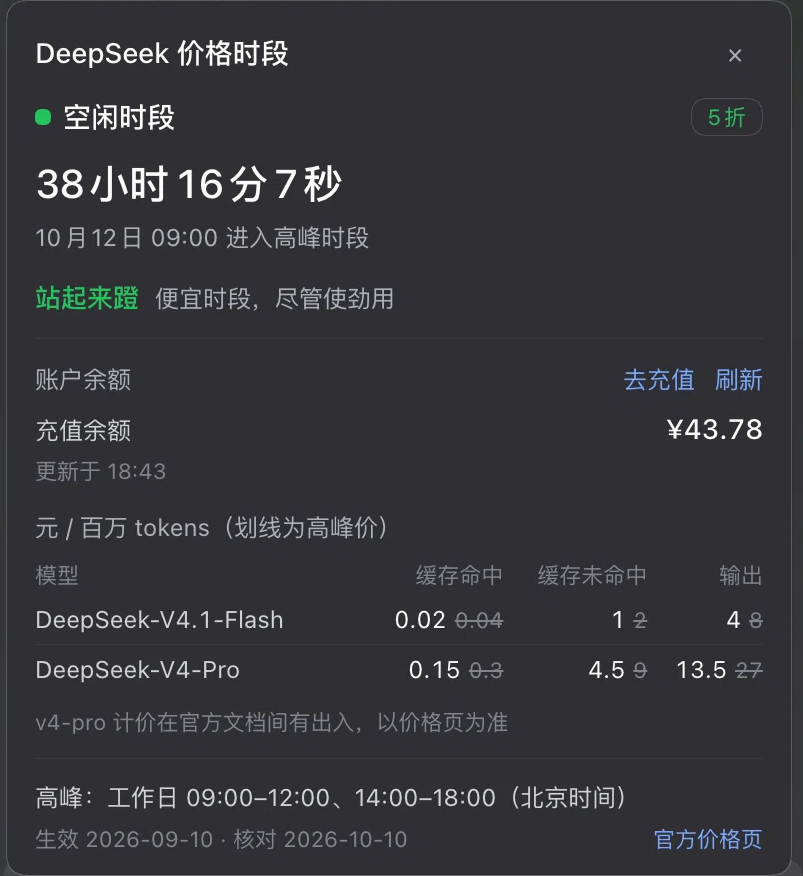

# 验证状态

> 环境 DSH `0.2.0-rc.2`（macOS 桌面版自带运行时）。安装类验证全部在**隔离的 `DSH_HOME=/tmp/…`** 中进行，
> 用后连同临时配置档与进程一并删除；未触碰在用的 `desktop` 配置档。

## 实测

| 项 | 结论 |
| --- | --- |
| 渲染 | 标记与面板均按设计渲染（截图见下），客户端 bundle 经 HMR 生效，槽位注册成功 |
| 侧栏口号 | 徽标同一行显示「空闲时段　站起来蹬　40:24」：状态主色、口号状态色、倒计时右对齐 |
| 面板口号 | 面板里是「**站起来蹬**　便宜时段，尽管使劲用」：口号状态色加粗、解释弱化色小字 |
| 面板层级 | 14 行，顺序为 状态 → 剩余时间与切换时刻 → 口号 → 账户余额 → 价目表 → 规则与来源；实现细节不在面板内 |
| 深色 · 侧栏 | 徽标在深色主题下同样清晰：状态主色、口号绿色、倒计时弱化色（背景亮度中位数 59/255） |
| 深色 · 面板 | 14 行版式与浅色一致；余额区块、划线高峰价、灰色说明、蓝色链接在深底上均可辨（背景亮度中位数 48/255） |
| 余额展示 | 浅色与深色面板都按真实账户渲染「账户余额」区块：充值余额右对齐、两位小数；赠送余额为 0 时该行不出现；「去充值」「刷新」在标题行右端；`更新于 18:43 / 18:44` 与截图时刻一致 |
| 数值 | 截图倒计时与 `src/policy.js` 的计算**吻合**：侧栏 `40:24` = 周六 16:36 → 周一 09:00；深色侧栏 `38:59` = 18:00 → 周一 09:00；面板 `38 小时 15 分 35 秒`（18:44:25）与深色面板 `38 小时 16 分 7 秒`（18:43:53）同指周一 09:00 |
| 界面语言 | 切换时刻显示为 `10 月 12 日 09:00`（中文日期 + 24 小时制）；修正前是 `10/12, 09:00 AM` |
| 弹层背景 | 同参数对比度拉伸下：改动前能还原出背后的正文碎片，改动后只剩纯色背景 |
| 测试 | `node --test test/` — 38 项全绿（规则 12 · 余额 16 · 产物与清单 10） |
| 构建产物 | `--check` 与源一致；`node --check client.js` 语法通过 |
| 余额口径 | `src/balance.js` 的格式化按开放平台 Web 客户端口径逐例验证：`0E-16`/`5.0000000000000000` 数值不漂移、千分位、正数截断、`<0.01`、负数进位（`-0.999` → `-¥1.00`）；与「设置 → 账户」的算法同源，但**未与真实账户逐笔对账** |
| 余额接线 | 可选 `remote.account` 注入、`getState`/`getBalance` 调用与 metadata 形状、失败保留上次结果并标 stale、登出、dispose —— 均由 `test/bundle.test.mjs` 以桩服务端断言 |
| 安装 · 本地目录 | 依赖写入 → 自动选入 `dsh.profile.bundles` → `--dump-config` 出现 `- id: price-tip`（未禁用） |
| 安装 · GitHub | 依赖记为 `github:hojas/dsh-price-tip`，运行时文件齐全，无需构建 |
| 安装 · tarball | 依赖记为 `file:…/dsh-price-tip-1.0.0.tgz`，同样自动选入 bundles |
| 服务端下发 | 引导图含该客户端行（见下），请求返回 `200 text/javascript`，内容与仓库 `client.js` 一致（仅多一行 Host 追加的 sourceMappingURL） |
| desktop 组合 | 把 `~/.dsh/profiles/desktop` 的清单/补丁复制到隔离配置档后，`price-tip` 行正常组合、无冲突 |

```json
// 引导图（window.__DSH_BOOT__）里的客户端行
{ "id": "dsh-price-tip", "url": "plugins/??dsh-price-tip/client.js&rev=…", "immediately": true,
  "inject": ["@deepseek-ai/dsh-client-locale", "@deepseek-ai/dsh-client-ui-sidebar"] }
```

## 截图

### 浅色主题

侧栏底部的标记（绿色月牙 = 空闲时段，状态文案旁是绿色口号，右侧为距下次切换的倒计时）：


完整窗口（侧栏底部即本插件；已裁掉底部账号区）：


点击标记展开的面板（含 v1.1 的「账户余额」区块）：


### 深色主题

侧栏底部的标记（与浅色同一版式，状态主色、口号绿色、倒计时弱化色）：


点击标记展开的面板（与浅色同一版式；余额区块与划线的高峰价在深底上依然可辨）：



## 未验证

截图覆盖**浅色与深色两套主题下的侧栏与面板**（完整窗口仅浅色），两张面板截图都已包含 v1.1 的余额区块。
以下仍只有代码审阅与结构测试：

- **余额的三种降级形态**——未登录、读取失败（保留上次结果 + stale 标注）、无账户控制器的配置档（整块隐藏），
  均未实际触发过（截图是已登录且读取成功的那一种）。
- **登录态切换**——签入/登出后 `credentials/record-updated` 触发重读，静态截图无法证明。
- **多币种钱包**——只按代码逐行渲染，未见过 CNY/USD 同时存在的真实返回。
- **刷新按钮与去充值链接的行为**——点击后的重读结果与跳转未验证，截图只证明它们是可点的按钮/链接。
- **侧栏折叠（rail）态**——宽度小于约 240px 时改走 36×36 的图标样式，未实拍。
- **高峰时段的口号**——现有五张截图都是空闲时段，因此「心疼着蹬 / 贵时段，蹬一下心疼一下」这一支只有字典与分支测试覆盖，没有实拍。
- **交互行为**——Escape / 点击空白关闭、跨过切换时刻时文案翻转；静态截图无法证明。

若实际观感与预期不符（位置、配色、宽度、弹层遮挡等），把现象告知即可修正。

## 方法

- 客户端断言只做到「模块包装 + 插件生命周期 + 清单」一层：不模拟 React、不构造 DOM、不做截图，
  不用假渲染替代真实验证。
- 规则与价格读自 [官方价格页](https://api-docs.deepseek.com/zh-cn/quick_start/pricing)及其存档、官方发布说明；
  节假日逐条用 `date` 复核星期。官方文档未明确处的假设见 [development.md](development.md)。
